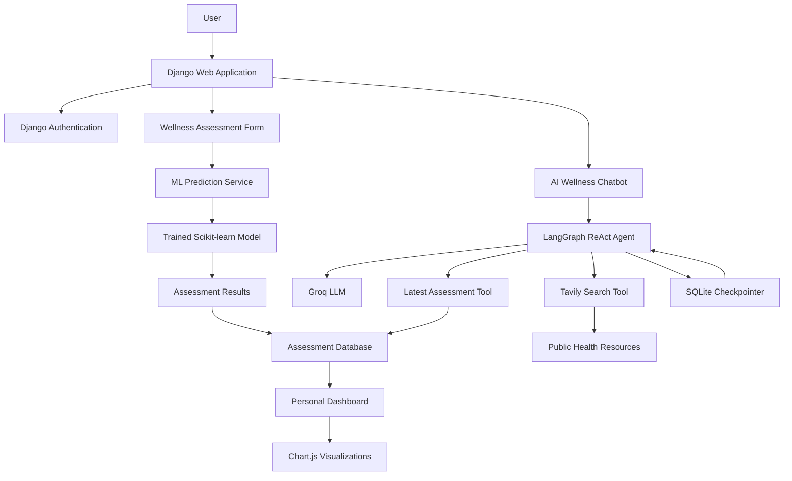

# MindWell AI 🧠

### An AI-Powered Mental Wellness & Lifestyle Tracking Platform

MindWell AI is a web-based mental wellness platform that combines **Machine Learning, Django, LangGraph, Groq, and Tavily** to help users explore their lifestyle habits, understand their predicted wellness scores, and access personalized wellness guidance.

The platform allows users to complete wellness assessments, view their prediction results, track assessment history, and interact with an AI wellness assistant that can retrieve their latest assessment and search trusted health resources.

The application also uses LangGraph checkpointing to preserve chatbot conversations across sessions, allowing users to continue their conversations when they return.

> **Disclaimer:** MindWell AI is an educational and wellness-support project. Its machine learning predictions are experimental and are not a medical diagnosis, clinical assessment, or substitute for professional mental health care.

---

## 🌐 Live Demo

**Try MindWell AI:** [Open Live Application](https://YOUR-LIVE-URL)

> Replace the placeholder URL with your deployed application's actual URL.
> If the project is not deployed yet, remove the link until it is available.

### Demo Account

If you provide a demo account, add its details here:

- **Application URL:** YOUR-LIVE-URL
- **Username:** YOUR-DEMO-USERNAME
- **Password:** Do not publish a real or personal password.

Alternatively, visitors can register for their own account.

**Note:** The live application depends on the hosting provider's availability,
database persistence, and the configured Groq and Tavily API quotas.


## 📸 Screenshots

Explore the main features of MindWell AI.

### 🏠 Dashboard
<!-- Replace with a screenshot of your actual dashboard -->


### 📝 Wellness Assessment
<!-- Replace with a screenshot of your assessment form -->


### 📊 Assessment Results & Progress
<!-- Replace with a screenshot of your results and charts -->


### 🤖 AI Wellness Chatbot
<!-- Replace with a screenshot of your working chatbot -->


### 💡 AI-Generated Recommendations
<!-- Replace with a screenshot of your recommendations -->


## ✨ Features

### 🤖 Machine Learning Predictions
- Predict a wellness score using a trained Scikit-learn model.
- Use self-reported lifestyle and behavioral information as model inputs.
- Integrate the trained model into Django through a dedicated prediction service.
- Store assessment results for later review.

### 🔐 User Authentication
- User registration and login.
- Protected pages using Django authentication.
- User-specific assessment records.
- Personalized dashboards and assessment history.

### 📊 Wellness Dashboard & Progress Tracking
- View the latest predicted wellness score.
- Review previous assessments.
- Track reported sleep, stress, physical activity, study hours, and social media usage.
- Visualize assessment trends using Chart.js.
- Explore weekly summaries based on recorded assessments.

### 💬 AI Wellness Chatbot
- Conversational wellness assistance powered by Groq.
- LangGraph-based ReAct agent with tool-calling capabilities.
- Retrieve the authenticated user's latest wellness assessment.
- Search for relevant wellness information using Tavily.
- Maintain one continuous conversation thread per user.
- Restore previous conversation context after logging out or restarting the application, provided the database is preserved.

### 🔎 Web-Grounded Wellness Guidance
- Search public-health resources using Tavily.
- Retrieve information relevant to sleep, stress management, digital wellbeing, and healthy lifestyle habits.
- Provide practical suggestions informed by retrieved sources.
- Display source references when available.

### 💾 Persistent Conversation Memory
- Store LangGraph checkpoints in the existing Django SQLite database during development.
- Associate each conversation thread with its authenticated Django user.
- Restore saved conversation state when the user returns.
- Avoid manually resending the entire conversation history from the frontend.

---

## 🛠️ Technology Stack

| Technology | Purpose |
|---|---|
| Python | Core application language |
| Django | Backend framework, authentication, routing, and database integration |
| Scikit-learn | Machine learning prediction |
| Pandas | Data preparation and processing where required |
| Joblib | Loading the trained model artifact |
| LangChain | LLM integration and tool definitions |
| LangGraph | ReAct agent execution and conversation state |
| Groq | LLM inference |
| Tavily | Web search and wellness resource retrieval |
| SQLite | Development database and LangGraph checkpoint storage |
| PostgreSQL | Potential production database |
| HTML, CSS, JavaScript | Frontend |
| Bootstrap 5 | Responsive interface |
| Chart.js | Data visualization |

---

## 🏗️ System Architecture



### How the AI chatbot works

1. The authenticated user sends a message through the Django interface.
2. Django passes the message and authenticated user to the chat service.
3. LangGraph restores the conversation state associated with the user's thread ID.
4. The Groq-powered agent determines whether a tool is needed.
5. The agent can retrieve the user's latest assessment or invoke the Tavily search tool.
6. The agent uses the available results to generate a response.
7. LangGraph saves the updated conversation state in SQLite.

The agent decides when to use its tools; it does not necessarily call every tool for every message.

---

## 📁 Project Structure


```text
myproject/
│
├── manage.py
├── requirements.txt
├── .gitignore
├── .env.example
├── README.md
│
├── myproject/
│   ├── settings.py
│   ├── urls.py
│   └── ...
│
├── accounts/
│   ├── models.py
│   ├── views.py
│   ├── urls.py
│   └── ...
│
├── assessments/
│   ├── models.py
│   ├── views.py
│   ├── ml_service.py
│   ├── urls.py
│   └── ...
│
├── dashboard/
│   ├── views.py
│   ├── urls.py
│   └── ...
│
├── wellness_ai/
│   ├── agent.py
│   ├── chat_service.py
│   ├── services.py
│   ├── models.py
│   ├── views.py
│   ├── urls.py
│   └── ...
│
├── templates/
│   ├── base.html
│   ├── accounts/
│   ├── assessments/
│   ├── dashboard/
│   └── wellness_ai/
│
└── ml_models/
    └── mental_health_pipeline.joblib
    └── model_metadata.json
```


---

## ⚙️ Getting Started

### 1. Prerequisites

Install the following:

- Python 3.11 or another Python version compatible with your installed dependencies.
- Git.
- A Groq API key.
- A Tavily API key.
- The trained machine learning model artifact.

API access and usage limits depend on the provider's current plans.

### 2. Clone the Repository

```bash
git clone https://github.com/YOUR_USERNAME/YOUR_REPOSITORY.git
cd YOUR_REPOSITORY
```

Replace the repository URL with your GitHub repository.

### 3. Create a Virtual Environment

**Windows**

```bash
python -m venv venv
venv\Scripts\activate
```

**Linux / macOS**

```bash
python3 -m venv venv
source venv/bin/activate
```

### 4. Install Dependencies

```bash
python -m pip install --upgrade pip
pip install -r requirements.txt
```

Ensure your requirements include the packages used by your implementation, including Django, Scikit-learn, Joblib, LangChain, LangGraph, the Groq integration, Tavily integration, and SQLite checkpoint support.

### 5. Configure Environment Variables

Create a `.env` file in the project root.

Example configuration:

```dotenv
SECRET_KEY=replace-with-a-secure-django-secret
DEBUG=True

GROQ_API_KEY=your-groq-api-key
GROQ_MODEL=your-supported-groq-model-id

TAVILY_API_KEY=your-tavily-api-key
TAVILY_SEARCH_DEPTH=basic
```

Use a Groq model ID that is currently available to your account. Do not assume a model name remains supported indefinitely.

Configure Django to load these variables and ensure the settings names match those referenced in your application.

**Never commit `.env` to GitHub.** Keep a sanitized `.env.example` in the repository so other developers know which variables are required.

### 6. Place the Trained Model

Download or copy your trained model artifact into the location expected by your prediction service.

For example:

```text
model/trained_model.joblib
```

Update the model path in `assessments/ml_service.py` if necessary.

The saved model and the Scikit-learn version used to load it must be compatible. Ideally, use the same version used during training and validate predictions before deployment.

Only load model artifacts from trusted sources because Joblib and pickle-based formats can execute code during deserialization.

### 7. Configure the Database

For local development, Django can use SQLite.

Check that `settings.py` contains an appropriate default database configuration. Django normally creates `db.sqlite3` automatically when using its standard SQLite configuration.

Run migrations:

```bash
python manage.py migrate
```

If your project has pending migrations for its custom models, this command applies them.

### 8. Create a Superuser (Optional)

```bash
python manage.py createsuperuser
```

Follow the prompts to create an administrator account.

### 9. Start the Development Server

```bash
python manage.py check
python manage.py runserver
```

Open the local URL:

http://127.0.0.1:8000/

Register an account, complete an assessment, review the result, and open the AI wellness chatbot.

---

## 🔑 API Configuration

### Groq

Groq provides the language model used by the chatbot.

The application uses the configured model to:
- Understand user messages.
- Decide when to call available tools.
- Interpret assessment information.
- Generate conversational wellness guidance.

Obtain credentials from the official Groq Console:

https://console.groq.com/

### Tavily

Tavily supplies web search results to the wellness guidance tool.

The application can use it to retrieve information about general wellness topics such as sleep, stress management, physical activity, and digital wellbeing.

Obtain credentials from:

https://tavily.com/

Search results should be treated as external, untrusted content. Verify source quality, validate URLs, and do not include private user details in search queries.

---

## 🧠 Machine Learning Model

MindWell AI integrates a previously trained Scikit-learn model to predict a wellness score from assessment inputs.

The prediction workflow is:

1. Collect the required user inputs.
2. Validate and prepare the input data.
3. Pass the data to the saved model through the prediction service.
4. Return the predicted score.
5. Store the assessment and prediction in the database.
6. Make the saved result available to the user's dashboard and AI assistant.

The model's actual performance depends on its training data, evaluation results, and intended prediction target.

Before interpreting predictions, document the target variable, training dataset, evaluation metrics, expected input features, and score scale. A predicted score should not be described as a clinical diagnosis unless it has been appropriately validated for that purpose.

---

## 💬 LangGraph Conversation Memory

The chatbot uses LangGraph checkpointing to preserve conversation state.

Each user is associated with a thread ID generated by the Django backend:

```python
def get_thread_id(user):
    return f"mindwell-user-{user.pk}"
```

The chat service supplies that ID when invoking the agent.

This allows LangGraph to restore the corresponding conversation state and save updates after new interactions.

### Current Memory Behavior

- One persistent thread per Django user.
- SQLite-backed checkpoints during development.
- Conversation history can survive logout and application restarts when the database file remains intact.
- The website can display a limited number of recent messages.
- The saved conversation may contain more messages than are displayed.

The current implementation does not automatically expire old conversations. Long conversations can also increase token usage and eventually exceed the LLM's context window. Message trimming, summarization, and retention policies should be implemented before production use.

---

## 📈 Dashboard and Weekly Analytics

The dashboard is intended to help users explore changes in their recorded assessment information.

Potential visualizations include:

- Predicted wellness score over time.
- Weekly average reported sleep duration.
- Weekly average social media usage.
- Weekly average physical activity.
- Weekly average study hours.
- Counts of reported stress categories.
- Assessment completion history.

Weekly summaries should be based on actual records, with missing weeks represented as missing data rather than fabricated measurements.

If assessments are taken infrequently, weekly averages may represent only one or two observations. They should not be interpreted as continuous monitoring.

---

## 🔒 Security and Privacy

Because the application handles sensitive wellness information, security and privacy must be considered throughout development.

Recommended practices:

- Keep API keys and Django secrets in environment variables.
- Keep `.env`, private datasets, and the SQLite database out of version control.
- Protect dashboard, assessment, and chat routes with Django authentication.
- Filter assessment queries using the authenticated user.
- Derive LangGraph thread IDs on the server, never from arbitrary client input.
- Enable Django CSRF protection for state-changing requests.
- Validate request data and enforce reasonable input limits.
- Use HTTPS and secure cookie settings in production.
- Restrict database and log access.
- Provide clear consent for sending relevant information to third-party AI providers.
- Implement user-controlled conversation deletion and a defined data-retention policy.
- Avoid logging sensitive chat content unnecessarily.
- Add rate limiting and appropriate abuse protections before public deployment.

SQLite is suitable for local development. For production, use a database and hosting configuration that support persistent storage, backups, appropriate concurrency, and secure access controls.

---

## 🩺 Responsible AI and Mental Health Safety

MindWell AI is a wellness-support application, not a medical device or clinical decision system.

The AI assistant should:

- Avoid diagnosing mental health conditions.
- Avoid prescribing medication or treatment.
- Explain that predicted scores are experimental.
- Distinguish self-reported habits from clinically established findings.
- Avoid unsupported claims about the causes of changes in a user's score.
- Encourage qualified professional support when appropriate.
- Provide a clear route to immediate human or emergency assistance when a user may be in danger.

A system prompt alone is not a sufficient safety mechanism. Independent safety handling, testing, and appropriate escalation guidance are necessary before real users rely on the application.

---

## 🚀 Deployment

The application can be adapted for deployment to a suitable cloud hosting provider.

Before deploying:

1. Set `DEBUG=False`.
2. Configure a strong production `SECRET_KEY`.
3. Configure `ALLOWED_HOSTS` and trusted origins.
4. Use HTTPS and secure cookies.
5. Configure persistent database storage and backups.
6. Keep API keys in the hosting provider's secret manager or environment variables.
7. Install and pin compatible dependencies.
8. Run database migrations.
9. Configure static file collection and serving.
10. Test authentication, assessment ownership, chatbot persistence, and API failures in the deployed environment.

Some free hosting plans have ephemeral filesystems, usage quotas, or services that sleep when idle. Do not assume that a local SQLite database will persist on such platforms. Verify the hosting provider's current storage and service limits before deploying.

---

## 🗺️ Future Improvements

Potential future enhancements include:

- Daily wellness check-ins.
- More detailed assessment history and analytics.
- Conversation summarization and bounded LLM context.
- User-controlled chat deletion and retention settings.
- Improved source attribution and validation for retrieved guidance.
- Independent safety checks and urgent-support routing.
- Automated testing for user data isolation and tool behavior.
- PostgreSQL for production deployments.
- Improved accessibility and mobile responsiveness.
- Model evaluation reports and prediction explanations where scientifically appropriate.

---

## 🤝 Contributing

Contributions and suggestions are welcome.

1. Fork the repository.
2. Create a feature branch.
3. Make your changes.
4. Run the project's checks and tests.
5. Submit a pull request describing the changes.

Please do not submit private health information, API keys, real user conversations, or sensitive datasets in issues or pull requests.


*MindWell AI — Understand your habits, explore your wellbeing, and build healthier routines.*
